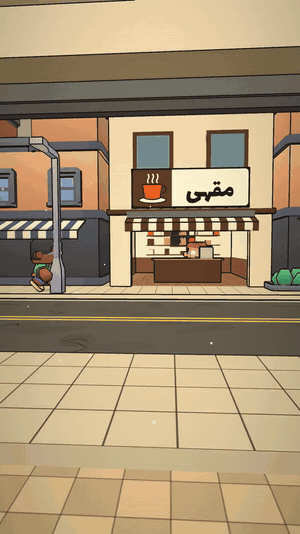
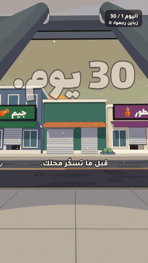
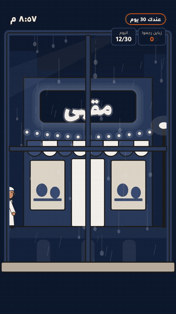
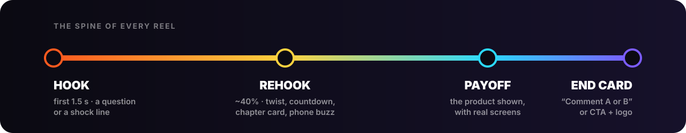
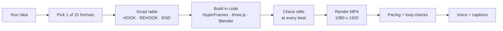

<div align="center">



# AI Reels: make viral Reels, TikToks and Shorts with Claude Code

**The Claude Code skill that turns one prompt into a scroll-stopping vertical video, built in code and rendered on your own machine.**
15 proven formats × 14 styles · hook in 1.5 s · 3D with three.js and Blender · Arabic and English · no AI video models

[](https://docs.claude.com/en/docs/claude-code/skills)
[](#-the-15-formats)
[](#-the-14-styles)
[](#-why-ai-reels)
[](LICENSE)

[](https://threejs.org)
[](https://www.blender.org)
[](https://gsap.com)
[](https://elevenlabs.io)
[](#)
[](#)
[](#)

**[Install](#-install-in-10-seconds)** · **[The 15 formats](#-the-15-formats)** · **[The 14 styles](#-the-14-styles)** · **[How it works](#-how-it-works)** · **[Prompts to try](#-prompts-to-try)** · **[FAQ](#-faq)**

</div>

---

## 🎥 Made with AI Reels

<div align="center">

Real reels, rendered on one PC with this skill: no stock footage, no AI video models, Arabic voiceover by ElevenLabs.

<table>
<tr>
<td align="center" width="33%"></td>
<td align="center" width="33%"></td>
<td align="center" width="33%"></td>
</tr>
<tr>
<td align="center"><b>Toon POV story</b><br/><sub>format 1 × style S7 · three.js</sub></td>
<td align="center"><b>Toon POV story</b><br/><sub>format 1 × style S7 · Blender + RTX GPU</sub></td>
<td align="center"><b>Comment-keyword CTA</b><br/><sub>format 4 × style S8 · flat vector</sub></td>
</tr>
</table>

<sub>36-second Arabic reels with hook, rehook, chapter cards, HUD counters and real app screens. Previews are cropped loops.</sub>

</div>

---

## ⚡ Install in 10 seconds

```bash
npx skills add krispx2811/ai-reels
```

Or copy [`skills/ai-reels/`](skills/ai-reels) into `~/.claude/skills/ai-reels/`. Then open Claude Code and say:

```text
make me a 20 second reel for my barber shop, hook in the first second
```

> If AI Reels saves you an afternoon, **[give it a ⭐](https://github.com/krispx2811/ai-reels)**. It helps other creators find it.

---

## 🎯 Why AI Reels

Most "AI video" tools hand you a random clip you can't edit. AI Reels gives Claude Code a **playbook of formats that already go viral**,
then builds every frame in code, so you can change any word, colour or timing and render again in seconds.

| | |
|---|---|
| 🪝 **Hooks that hold** | Every format follows the spine of viral reels: hook in 1.5 s, rehook at 40%, payoff, end card. |
| 🧱 **Built, not generated** | HyperFrames (HTML + GSAP), three.js and Blender. Deterministic renders, no credits, no watermark. |
| 📱 **Your real product** | Real app screens, logos and mascots go on phones, signs and cards. No fake UI. |
| 🌍 **Arabic and English** | Right-to-left Arabic shaped correctly in captions, signs and 3D type (Gulf dialect tested). |
| ✅ **Checked, not guessed** | Pacing check from real pixels (no dead gaps, no flashes) and a pixel-perfect loop check. |
| 🔊 **Voice optional** | ElevenLabs voice lines timed to each shot and mixed onto the video. |

<div align="center">

</div>

---

## 🎬 The 15 formats

<div align="center">

</div>

<details>
<summary><b>📖 Story formats (1 to 7)</b>: taken apart from real viral reels</summary>

| # | Format | What it looks like | Great for |
|---|---|---|---|
| 1 | Toon POV story | Cel-shaded 3D, black outlines, first person with your hands in frame, "DAY 1" chapter cards | Day-in-the-life, survival stories, product in hand |
| 2 | "What if" life sim | 2nd-person narration, HUD counters (AGE 24 / LIVED 30 YEARS / PAUSE) | Big hypotheticals, "would you press it?" |
| 3 | You-decide thriller | Painted stills, phone UI inserts, money and time HUD, A or B ending | Fintech, scams, dilemmas |
| 4 | Vector motion comic | Flat vector art, clock stamps, giant text messages, countdowns | Tense POV stories, jobs, survival |
| 5 | Toy-figure cinema | Vinyl figures, moody light, last part's vote comments on screen | Serialized stories with polls |
| 6 | Blocky narrated story | Blocky avatars, bright worlds, one big word at a time | Kids and teen stories, mysteries |
| 7 | Dialogue explainer | Two characters, speech bubbles, LEVEL meter with wrong and right rules | Teaching a skill, objection handling |

</details>

<details>
<summary><b>🧊 3D showcase formats (8 to 15)</b>: inspired by the threejs.org gallery</summary>

| # | Format | What it looks like | Great for |
|---|---|---|---|
| 8 | Product hero film | Studio light, macro details, slow orbit, feature callouts | Launches, app features |
| 9 | Tiny world diorama | A miniature low-poly town, camera dives in | Before and after, local businesses |
| 10 | 3D kinetic type | Giant words that fly, stack and turn | Hooks, slogans |
| 11 | Particle data globe | Points form maps, arcs and logos, counters climb | Growth numbers, coverage |
| 12 | Satisfying physics | Jelly, marbles, stamps dropping, perfect loops | Loop posts |
| 13 | Chase-cam ride | Car or scooter on a road, timer HUD | Delivery, "POV: your route" |
| 14 | Glass and liquid macro | Refraction, bubbles, bottles | Food, drinks, perfume |
| 15 | Cozy room story | One warm room, objects tell the story | Brand origin, a day in the life |

</details>

---

## 🎨 The 14 styles

A format is the story; a style is the look. **Mix any format with any style**: "Toon POV story × Neon Gulf night",
"Product hero film × Papercraft", "Tiny world diorama × Claymation". Every style is built in **Blender** or **three.js**.

<div align="center">

</div>

<details>
<summary><b>🖌 What each style ships with</b></summary>

Palette in hex · materials and shaders · lighting recipe · camera and lenses · motion rules · Arabic and Latin type
pairing · the Blender recipe and the three.js recipe · best formats · traps to avoid.
See [`references/styles.md`](skills/ai-reels/references/styles.md).

</details>

---

## 🗣 Arabic voiceover that sounds right

ElevenLabs `eleven_v4` with Arabic settings baked in (language code, text normalization, narration stability,
stitching between lines), selective tashkeel on words models misread, and a **local Whisper check** that transcribes
every line back and diffs it against the script, so a mispronounced word is caught before it ships.

---

## 🛠 How it works



1. **Pick a format.** Claude reads the format's breakdown: timing, caption system, overlays, end card, traps to avoid.
2. **Write the script as a table** with the hook and rehook marked, and wait for your yes.
3. **Build in code** with your real assets: free CC0 3D kits (Kenney), rigged characters with walk and idle animations.
4. **Look before rendering.** Stills at every beat are checked and fixed first.
5. **Render and verify** with the pacing check (no dead gap over 1 s, nothing flashing under 0.3 s).

---

## 💬 Prompts to try

```text
/ai-reels what kinds of videos can you make?
make a toon POV reel: you own a perfume shop and your best customer walks into the shop next door
turn this Instagram reel into the same style for my app: <link>
a 12 second satisfying loop of stamps dropping into a loyalty card
a "comment A or B" story in Arabic, Gulf dialect, 30 seconds, with a part 2 cliffhanger
a 3D product hero film of my app on a phone, three feature callouts, logo at the end
```

---

## 📦 Requirements

| Tool | Needed for |
|---|---|
| Node 22+ | HyperFrames rendering (`npx hyperframes`) |
| Python 3 | Pacing and loop checks |
| ffmpeg | Encoding, frame checks |
| Blender 4.2+ with a GPU *(optional)* | Blender-rendered 3D formats |
| ElevenLabs API key *(optional)* | Voiceover |

---

## ❓ FAQ

**Is this an AI video generator?**
It is a Claude Code skill. Claude writes the scene in code (HTML, three.js or Blender Python) and renders it locally.
No Sora, Kling, Runway or Veo style models are used, so there are no credits and every frame is editable.

**Can it make Instagram Reels, TikToks and YouTube Shorts?**
Yes. Every format renders vertical 1080 x 1920 at 30 fps, ready to upload.

**Does it support Arabic?**
Yes. Arabic is shaped in the browser and set right to left in captions, signs and 3D type, including Gulf dialect scripts.

**Can I use my own brand and app screens?**
That is the point: real screens, logos and mascots go on phones, signs and cards inside the scene.

**Is it free?**
The skill is MIT licensed. The tools it uses are free; voiceover needs your own ElevenLabs key.

**How is it different from Remotion or After Effects templates?**
It is a format playbook for an AI agent: the agent picks a proven viral structure, writes the script, builds the scene and
checks the pacing from real pixels, end to end.

---

## 🧪 Mix and match

| Prompt | Format | Style |
|---|---|---|
| "a café owner sees his regular walk into the shop next door" | 1. Toon POV story | S4 Neon Gulf night |
| "show 3 features of my app on a phone" | 8. Product hero film | S5 Keynote product |
| "a street where only one shop's customers come back" | 9. Tiny world diorama | S6 Clay diorama |
| "Ramadan offer reel" | 10. 3D kinetic type | S1 Gulf heritage |
| "how it works in 3 steps" | 7. Dialogue explainer | S11 Hand-drawn sketch |
| "a satisfying loop of stamps filling a card" | 12. Satisfying physics | S2 Claymation |

---

## ⭐ Star history

<div align="center">
<a href="https://star-history.com/#krispx2811/ai-reels&Date">

</a>
</div>

---

## 🙏 Credits

- `studio.js`, `pacing_check.py`, `_media.py`, `loop_check.py` come from the MIT-licensed claude-video-2 skill
  ([license](skills/ai-reels/scripts/LICENSE-claude-video-2.txt)).
- Rendering: [HyperFrames](https://hyperframes.heygen.com), [three.js](https://threejs.org), [Blender](https://www.blender.org), [GSAP](https://gsap.com).
- Free 3D assets: [Kenney](https://kenney.nl) (CC0).
- Reference reels and three.js gallery projects are linked, not copied; all rights stay with their creators.

<div align="center">

**MIT License** · Made with Claude Code

If this helped, **[⭐ star the repo](https://github.com/krispx2811/ai-reels)** and share a reel you made with it.

</div>
